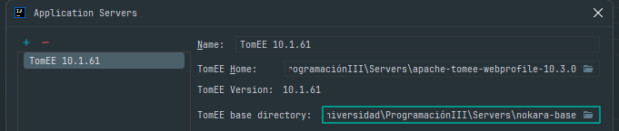
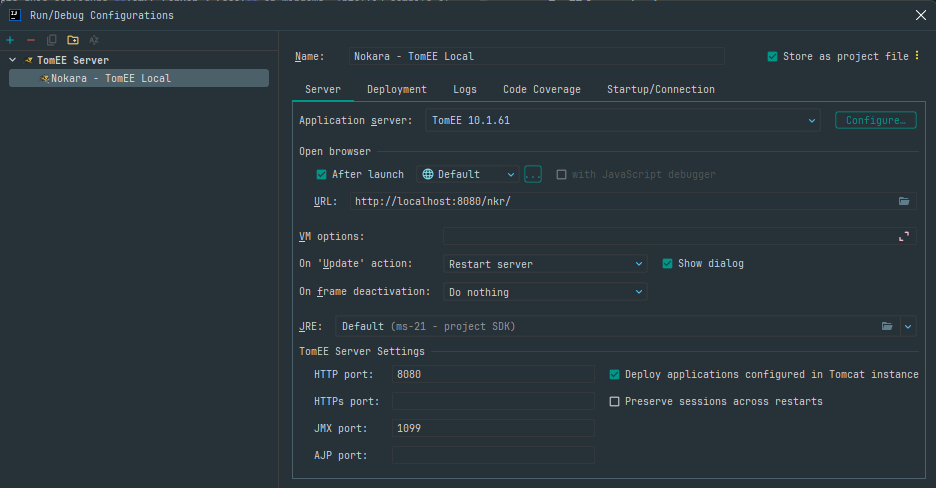
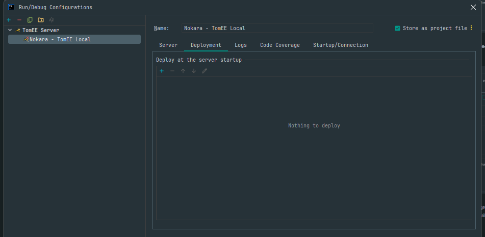
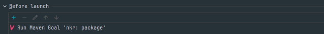
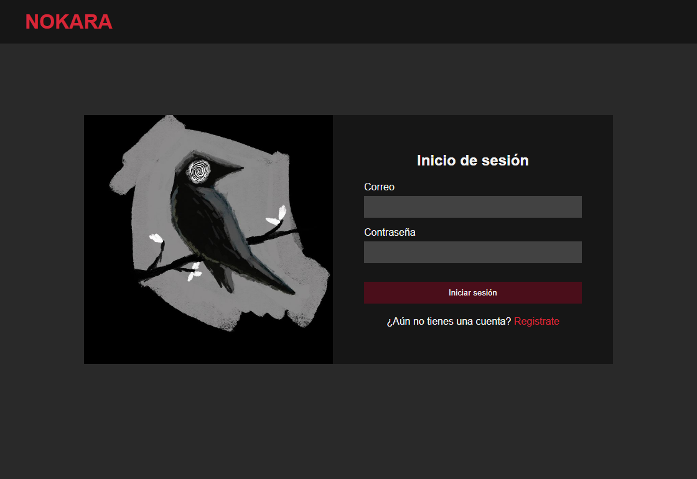

# Ejecutar Nokara con TomEE en IntelliJ IDEA

Esta guía configura **TomEE Server → Local** en Windows. IntelliJ compila el proyecto con Maven y TomEE publica la aplicación en [http://localhost:8080/nkr/](http://localhost:8080/nkr/).

## 1. Importa el proyecto y prepara MySQL

1. En IntelliJ, usa **File → Open** y selecciona la carpeta raíz de Nokara. Si Maven no aparece, haz clic derecho en [NKR-main/pom.xml](NKR-main/pom.xml) y elige **Add as Maven Project**.
2. En **File → Project Structure → Project**, selecciona un **JDK 21**. En **Settings → Build, Execution, Deployment → Build Tools → Maven → Runner**, selecciona el mismo JDK si Maven está usando otro.
3. Inicia MySQL o MariaDB. En tu cliente SQL, ejecuta [database_schema.sql](NKR-main/sql/database_schema.sql) con una cuenta que pueda crear la base `nokara` y las tablas `users`, `cases` y `documents`. Si ya tienes una cuenta para Nokara, comprueba que tenga permisos `SELECT`, `INSERT`, `UPDATE` y `DELETE` sobre `nokara.*`.
4. Si necesitas crear una cuenta para la instalación local, ejecuta estas sentencias con una cuenta autorizada para crear usuarios y conceder permisos. Reemplaza la contraseña de ejemplo antes de ejecutarlas.

```sql
CREATE USER 'nokara_app'@'localhost' IDENTIFIED BY 'cambia_esta_contrasena';
GRANT SELECT, INSERT, UPDATE, DELETE ON nokara.* TO 'nokara_app'@'localhost';
```

### Prepara el archivo `.env` y configura Windows

Desde la raíz del repositorio, copia [`.env.example`](.env.example) a `.env` con PowerShell. Si ya tienes un `.env`, abre el existente y actualiza las tres variables.

```powershell
Copy-Item .env.example .env
```

La plantilla contiene estos valores de ejemplo.

```dotenv
# Para MySQL 8 local con TLS habilitado, agrega ?sslMode=trust al final de la URL.
NOKARA_DB_URL=jdbc:mariadb://localhost:3306/nokara
NOKARA_DB_USER=nokara_app
NOKARA_DB_PASSWORD=cambia_esta_contrasena
```

| Variable | Valor que debes usar |
| --- | --- |
| `NOKARA_DB_URL` | La URL de la base de datos. Cambia `localhost` y `3306` si tu servidor usa otra dirección o puerto. Conserva el prefijo `jdbc:mariadb:` con MySQL o MariaDB, porque Nokara usa el controlador JDBC de MariaDB. |
| `NOKARA_DB_USER` | El nombre de la cuenta de base de datos, por ejemplo `nokara_app`. |
| `NOKARA_DB_PASSWORD` | La contraseña real de esa cuenta. |

Si usas **MySQL 8 en tu equipo** con TLS habilitado, configura `NOKARA_DB_URL=jdbc:mariadb://localhost:3306/nokara?sslMode=trust` para que una cuenta nueva pueda autenticarse. `sslMode=trust` cifra la conexión sin validar el certificado. Si el servidor está en otro equipo, usa `sslMode=verify-full` y configura un certificado de confianza. [Opciones TLS de MariaDB Connector/J](https://mariadb.com/docs/connectors/mariadb-connector-j/using-tls-ssl-with-mariadb-java-connector)

El `.env` guarda tus valores locales y Git lo ignora. Al arrancar, TomEE toma esos valores de las variables de entorno del proceso para configurar la conexión `NokaraDB`.

1. En Windows, busca **Editar las variables de entorno de tu cuenta**. En **Variables de usuario**, pulsa **Nueva…** o **Editar…** para configurar cada una de las tres variables.
2. En **Nombre de la variable**, escribe el nombre exacto, por ejemplo `NOKARA_DB_URL`. En **Valor de la variable**, pega solo el valor que aparece después del primer `=` en tu `.env`. Repite el paso para `NOKARA_DB_USER` y `NOKARA_DB_PASSWORD`.
3. Guarda los cambios, cierra IntelliJ por completo y vuelve a abrirlo desde el menú Inicio para que TomEE herede las variables. Si cambias algún valor en `.env` más adelante, actualiza también la variable de Windows y reinicia IntelliJ.

## 2. Prepara y registra el servidor local

Si ya tienes `Servers/nokara-base` configurado, pasa al registro en IntelliJ. En otra máquina, haz lo siguiente:

1. Descomprime **Apache TomEE 10.3.0 WebProfile** en `Servers/apache-tomee-webprofile-10.3.0`. En la misma carpeta `Servers`, crea `nokara-base`.
2. Copia la carpeta `conf` de la instalación a `nokara-base`. Dentro de esa base, crea también `logs`, `temp`, `webapps` y `work`.
3. En `nokara-base/conf/server.xml`, agrega `address="127.0.0.1"` al conector HTTP existente para el puerto `8080`. En el elemento **Host** de `localhost`, establece `deployOnStartup="true"` y `autoDeploy="false"`. IntelliJ puede regenerar esos dos valores en su copia de arranque y detectar el descriptor unos segundos después.
4. Crea `nokara-base/conf/Catalina/localhost/nkr.xml`. Usa la ruta absoluta del WAR en **tu** equipo. El nombre `nkr.xml` determina la ruta web `/nkr`.

```xml
<Context docBase="C:/ruta/Nokara/NKR-main/target/nkr-1.0.war" />
```

En IntelliJ, abre **Settings → Build, Execution, Deployment → Application Servers**. También puedes llegar desde **Run → Edit Configurations → Server → Configure…**. Agrega un servidor **TomEE Server** si todavía no está registrado. En **TomEE Home**, selecciona `Servers/apache-tomee-webprofile-10.3.0`. En **TomEE base directory**, selecciona `Servers/nokara-base`. Pulsa **Apply** u **OK**, según el diálogo. [Configuración de servidores en IntelliJ](https://www.jetbrains.com/help/idea/application-servers-settings.html)



*La instalación contiene TomEE. La base contiene la configuración local que apunta al WAR de Nokara. En esta versión, IntelliJ muestra `10.1.61`, la versión de Tomcat incluida en TomEE 10.3.0.*

## 3. Configura la ejecución en IntelliJ

1. Abre **Run → Edit Configurations** y selecciona **Nokara - TomEE Local**. Si el perfil no aparece, créalo con **+ → TomEE Server → Local**.
2. En la pestaña **Server**, selecciona el servidor registrado, el **JDK 21** y el puerto HTTP **8080**. Marca **Deploy applications configured in Tomcat instance**. Para abrir el proyecto automáticamente, usa **After launch** con `http://localhost:8080/nkr/`. [Opciones de ejecución de TomEE](https://www.jetbrains.com/help/idea/run-debug-configuration-tomee.html)



3. En **Deployment**, deja vacía la lista de artefactos. Si aparece `NKR-TOMCAT:war exploded` o `nkr:war exploded`, selecciónalo y pulsa **−**. TomEE cargará el WAR mediante `nkr.xml`.



4. En **Before launch**, elimina la tarea **Build Artifacts** si aparece. Agrega **+ → Run Maven Goal**, elige el módulo Maven `nkr` correspondiente a `NKR-main/pom.xml` y escribe `package`. Si esa misma tarea ya existe, consérvala. Pulsa **Apply** y **OK**. [Objetivos de Maven antes de ejecutar](https://www.jetbrains.com/help/idea/work-with-maven-goals.html)



*Maven genera `NKR-main/target/nkr-1.0.war` antes de que IntelliJ inicie TomEE.*

## 4. Ejecuta y comprueba el resultado

1. Selecciona **Nokara - TomEE Local** y pulsa **Run**. En la consola, espera a que aparezca el despliegue de `nkr.xml`. `Server startup` indica que TomEE arrancó. El descriptor confirma que empezó el despliegue de Nokara.
2. Abre [http://localhost:8080/nkr/](http://localhost:8080/nkr/). Debe aparecer el formulario de inicio de sesión.



3. Abre [http://localhost:8080/nkr/health](http://localhost:8080/nkr/health) o ejecuta este comando en una terminal:

```powershell
curl.exe -i http://localhost:8080/nkr/health
```

El resultado esperado es **HTTP 200** y el cuerpo `{"tomee":"up","database":"up"}`. Esto comprueba que TomEE puede conectarse y consultar las tres tablas de Nokara.

4. En una base local de prueba, regístrate desde el formulario de Nokara e inicia sesión con la cuenta que acabas de crear. Así compruebas que Nokara puede guardar y consultar usuarios.

IIS puede seguir atendiendo en [http://localhost/](http://localhost/) por el puerto `80`. Detén TomEE con el botón **Stop** de IntelliJ.

## Si algo falla

| Síntoma | Qué revisar |
| --- | --- |
| IntelliJ menciona `NKR-TOMCAT:war exploded` | Selecciona **Nokara - TomEE Local** y retira esa referencia de **Deployment** y **Before launch**. |
| TomEE arrancó, pero `/nkr/` devuelve **404** | Espera el despliegue de `nkr.xml`. Si no aparece, comprueba la base seleccionada, la casilla de despliegue y que el WAR exista en la ruta del descriptor. |
| El puerto `8080` ya está en uso | Detén la ejecución anterior de TomEE o identifica el proceso que ocupa el puerto. IIS en el puerto `80` puede seguir activo. |
| `/nkr/health` devuelve **503** con `"database":"down"` | Consulta la consola de TomEE y busca `Error verificando NokaraDB` para identificar la causa. |
| La consola indica que se rechazó la conexión | Confirma que MySQL o MariaDB esté en ejecución y que el host y el puerto de `NOKARA_DB_URL` sean correctos. Para la instalación de ejemplo, ejecuta `Test-NetConnection localhost -Port 3306` en PowerShell y comprueba que `TcpTestSucceeded` sea `True`. |
| La consola muestra `Access denied` | Prueba la conexión en tu cliente SQL con los mismos datos de `.env`. Revisa la cuenta, la contraseña y los permisos sobre `nokara.*`. |
| La consola muestra `RSA public key is not available client side` | Si usas MySQL 8 local, verifica que TLS esté habilitado y agrega `?sslMode=trust` a `NOKARA_DB_URL`, como se indica en la sección de configuración. |
| La consola indica que falta la base o alguna tabla | Ejecuta `database_schema.sql` en el servidor indicado por `NOKARA_DB_URL` y verifica que `nokara` contenga `users`, `cases` y `documents`. |
| La consola muestra `${NOKARA_DB_URL}` o el problema empezó tras cambiar `.env` | Revisa que las tres variables de usuario de Windows coincidan con `.env`. Cierra IntelliJ por completo y vuelve a abrirlo antes de arrancar TomEE. |
